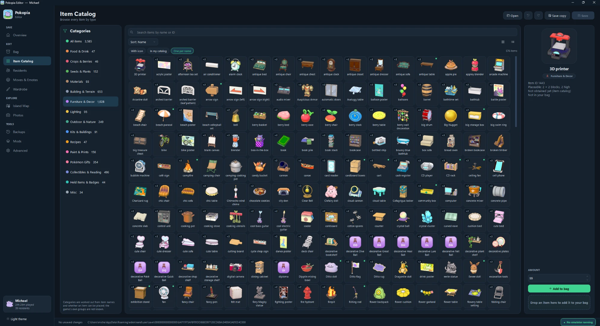
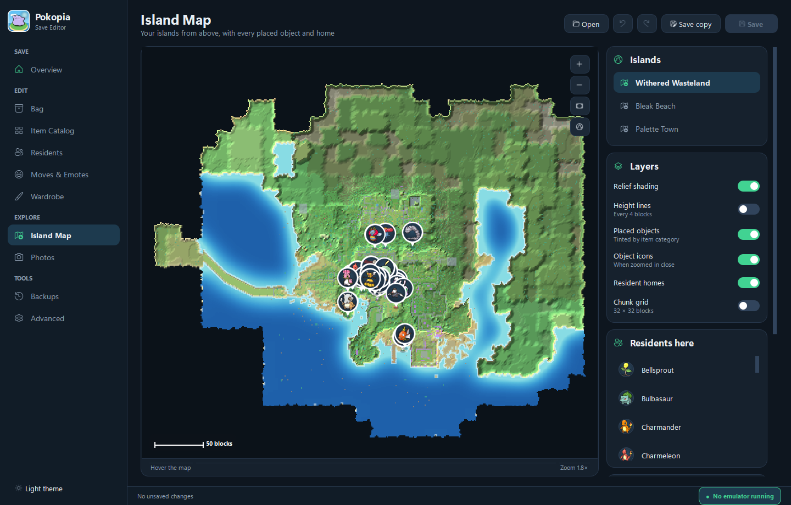
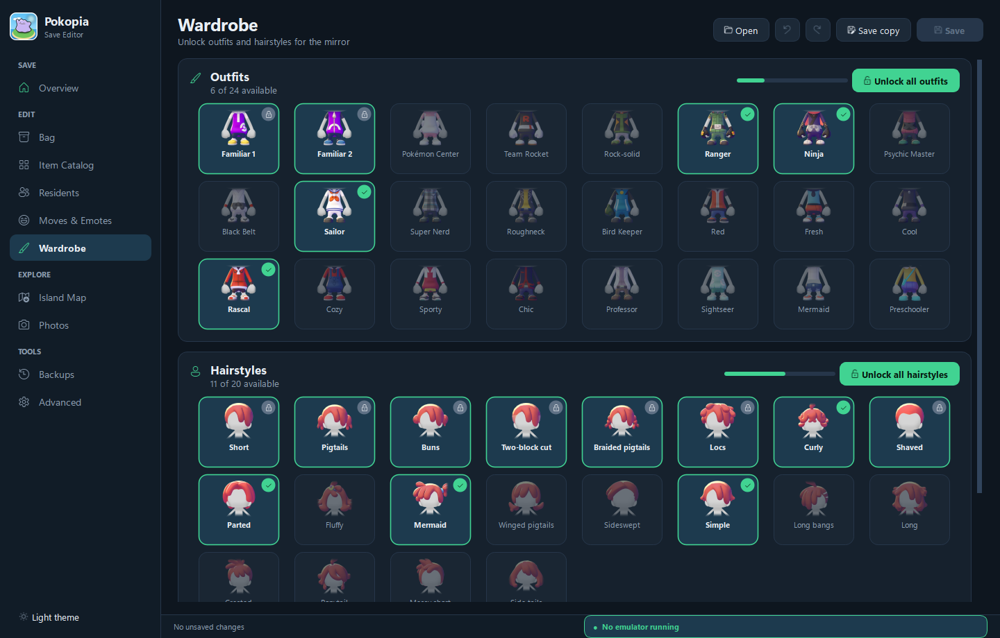
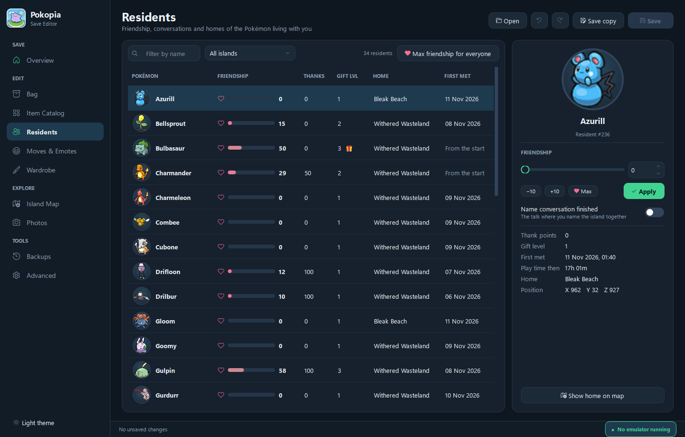
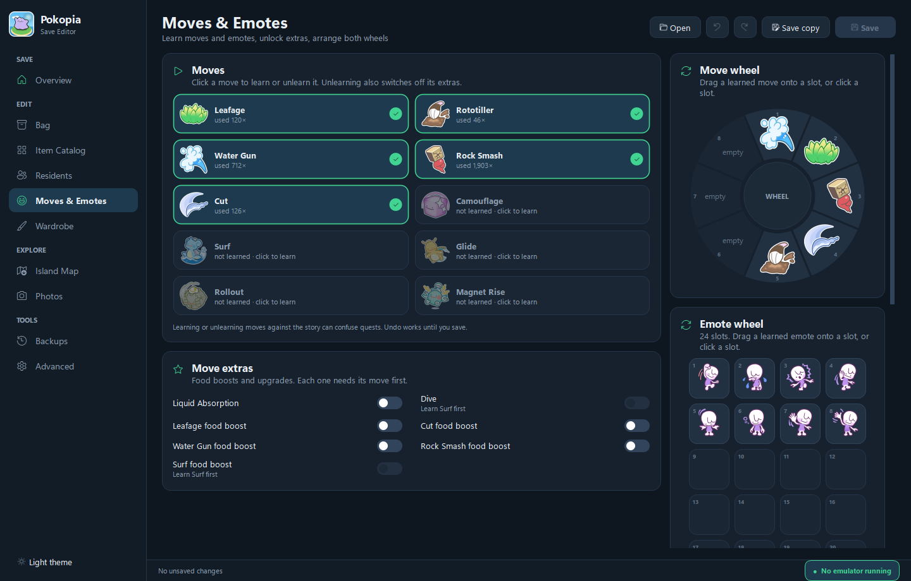
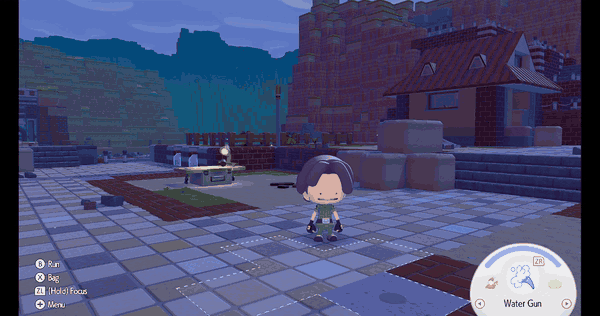

<div align="center">


# Pokopia Editor

**Edit your Pokopia save: bag, residents, moves, emotes and wardrobe. View your islands and photos. Install game mods.**

[](https://github.com/cycalo/Pokopia-Editor/releases/latest)





</div>

---

## 🚀 Getting started

1. **[Download `PokopiaEditor.exe`](https://github.com/cycalo/Pokopia-Editor/releases/latest)**. There's nothing to install.
2. **Close your emulator.**
3. **Double-click the exe.** It finds your save on its own.

Supported emulators: **Eden · Yuzu · Suyu · Sudachi · Citron · Torzu · Ryujinx**.
If your save isn't found, click **Open → Browse for a folder**.

> [!NOTE]
> If Windows shows *"Windows protected your PC"*, click **More info → Run anyway**.
> The warning appears because the app is new and unsigned.

---

## ✨ What you can do

| | Page | |
|:-:|---|---|
| 🏠 | **Overview** | Rename your player, see your stats, and use one-click actions: max friendship, learn every emote, unlock the wardrobe |
| 🎒 | **Bag** | Drag items into your bag, swap slots, copy with Ctrl, set amounts |
| 📖 | **Item Catalog** | Browse and search every item by category, then double-click to add it |
| 💛 | **Residents** | Set friendship, see when you met each resident, and find their home on the map |
| ✨ | **Moves & Emotes** | Learn or unlearn with a click, then set up your move and emote wheels |
| 👕 | **Wardrobe** | Unlock any outfit or hairstyle, or all of them at once |
| 🗺️ | **Island Map** | See each island from above with everything you've placed. Export it as a PNG |
| 📷 | **Photos** | Browse your in-game album and export full-size photos |
| 🛟 | **Backups** | Make, compare and restore backups |
| 🧩 | **Mods** | Play as Ditto or any other Pokémon, fly as flying Pokémon, and change Pokémon while the game is running. See [mods/](mods/) |

<table>
  <tr>
    <td></td>
    <td></td>
  </tr>
  <tr>
    <td align="center"><b>Island Map</b></td>
    <td align="center"><b>Wardrobe</b></td>
  </tr>
  <tr>
    <td></td>
    <td></td>
  </tr>
  <tr>
    <td align="center"><b>Residents</b></td>
    <td align="center"><b>Moves & Emotes</b></td>
  </tr>
</table>

---

## 🧩 Mods



### Play as Pokemon <sub>(experimental)</sub>

Turn into Ditto or any other Pokémon and walk around as it. It doesn't have to live in your town.

| Hold | Does |
|---|---|
| **ZL + D-pad Left** | Turn into the chosen Pokémon and stay that way |
| **ZL + D-pad Right** | Turn back into your character |
| **ZR** as a flying Pokémon | Take off, hold to rise |
| **ZL** while flying | Descend; keep holding it on the ground to land |
| **ZL + ZR** while flying | Drop out of the air |

1. Open the editor's **Mods** page and press **Install**.
2. Restart the game and tick **Play as Pokemon** under its Properties → Add-Ons.
3. With the game running, pick a Pokémon under **Change Pokémon while playing** and press **Transform**. No restart is needed.

The button combo uses the Pokémon you picked last, or Ditto until you pick one. Changing Pokémon while playing needs the emulator and the editor on the same Windows PC. On a console, choose one Pokémon in the list before you install instead.

**Only for Pokopia 2.0.0, update 655360.** On other versions the patch is not applied.

Play as Pokemon replaces the older **Always Ditto** and **Play as Resident** mods. If you have them, press **Update** on the Mods page and the editor removes them for you.

Pokémon that hover or fly in the game, such as Charizard, Scyther and Noctowl, can fly with their own hover and flying animations. Let go of both buttons to hover in place.

Ditto, Pokémon that live in your town, and a handful of others have been tested. Flying has been tested as Charizard, Scyther and Noctowl. The rest are taken from the game's data and may not all work.

Want the mod without the editor? Download it on its own:

- [**`PlayAsPokemon-emulator.zip`**](https://github.com/cycalo/Pokopia-Editor/releases/latest/download/z-PlayAsPokemon-emulator.zip): unzip into your emulator's `load` folder, then tick **Play as Pokemon** under the game's Properties → Add-Ons
- [**`PlayAsPokemon-SD-card.zip`**](https://github.com/cycalo/Pokopia-Editor/releases/latest/download/z-PlayAsPokemon-SD-card.zip): unzip onto the SD card for Atmosphère-style custom firmware (untested)

Details are in [mods/play-as-pokemon](mods/play-as-pokemon/).

---

## 🛡️ Your save is safe

- 💾 **Automatic backup** before every save, in `Documents\Pokopia_Save_Backups`
- 👀 **See every change** before it's written
- ↩️ **Undo / redo** everything, or restore any backup from the Backups page
- ⚠️ **Emulator check**: you get a warning if the emulator is still running
- 🔄 If the game saves while the editor is open, press **F5** to reload

---

## ⌨️ Shortcuts

| Keys | Action | | Keys | Action |
|---|---|---|---|---|
| `Ctrl+O` | Open a save | | `Ctrl+Z` | Undo |
| `Ctrl+S` | Save | | `Ctrl+Y` | Redo |
| `Ctrl+F` | Search | | `F5` | Reload |
| `Ctrl+1`–`9` | Switch page | | | |

---

<details>
<summary><b>🛠️ Running from source</b></summary>

<br>

Requires Python 3.

```bash
py -m pip install PySide6-Essentials pillow
py pokopia_gui.py
```

Command line tool: `py pokopia_cli.py --help`

Build the exe:

```bash
py -m pip install pyinstaller
py -m PyInstaller PokopiaEditor.spec --noconfirm
```

The exe stores its settings in `%APPDATA%\Pokopia Editor`.

</details>

<div align="center">
<sub>Code released under the <a href="LICENSE">MIT License</a>. The license covers the editor's code only: Pokémon names, icons and other game assets belong to Nintendo, Game Freak and The Pokémon Company. Fan-made tool, not affiliated with them.</sub>
</div>
