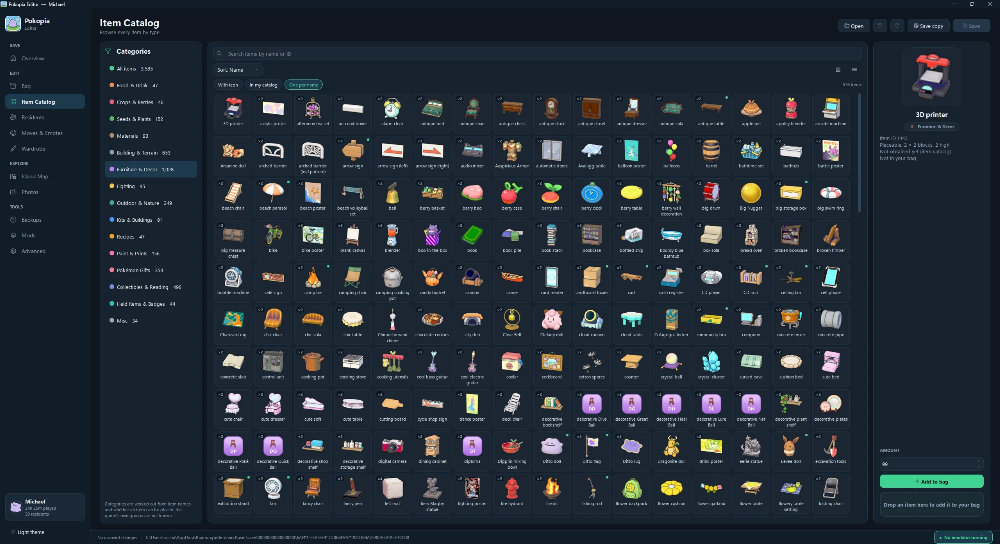

<div align="center">


# Pokopia Editor for Linux

**Edit your Pokopia save: bag, residents, moves, emotes, wardrobe, collection and your islands. Install game mods.**


</div>

---

## 🚀 Getting started

This is the Linux port maintained by [frinimini](https://github.com/frinimini/Pokopia-Editor-Linux),
based on [cycalo/Pokopia-Editor](https://github.com/cycalo/Pokopia-Editor).
See [credits and licenses](CREDITS.md) and [contribution guidelines](CONTRIBUTING.md).

Run from source on Linux with Python 3 and venv support installed.

```sh
git clone https://github.com/frinimini/Pokopia-Editor-Linux.git
cd Pokopia-Editor-Linux
python3 -m venv .build-venv
.build-venv/bin/python -m pip install -r packaging/requirements-linux.txt
.build-venv/bin/python pokopia_gui.py
```

Close your emulator before opening a save. The editor searches standard Linux emulator
save locations. Use **Open → Browse for a folder** to select a save manually, including
Recompia saves. The save folder contains `G00/CMNDAT.BIN`.

Download the [Linux AppImage prerelease](https://github.com/frinimini/Pokopia-Editor-Linux/releases/tag/v1.9.2-linux.1),
or follow [AppImage build instructions](#linux-build) to build it yourself.
The AppImage has been built and tested on Ubuntu 26.10 x86_64 and requires glibc 2.44.
GUI startup, all 12 pages with a real save copy, and 11 save round-trip/edit checks passed.
Older distributions have yet to be verified. The prerelease includes checksums, source code and bundled dependency notices.

Linux support includes folder opening, XDG settings, emulator process detection and
bundled toolbar icons. Experimental Linux live memory editing supports the verified
Pokopia 2.0.0 build in Lichii. See [Linux live memory editing](#linux-live-memory-editing).

Upstream Windows builds are available from
[cycalo's releases](https://github.com/cycalo/Pokopia-Editor/releases/latest).

---

## ✨ What you can do

| | Page | |
|:-:|---|---|
| 🏠 | **Overview** | Rename your player, see your stats, and use one-click actions: max friendship, learn every emote, unlock the wardrobe |
| 🎒 | **Bag** | Drag items into your bag, swap slots, copy with Ctrl, set amounts |
| 📖 | **Item Catalog** | Browse and search every item by category, then double-click to add it. Expansion Pass and event items are tagged and can be filtered |
| 💛 | **Residents** | Set friendship, see when you met each resident, and find their home on the map |
| ✨ | **Moves & Emotes** | Learn or unlearn with a click, then set up your move and emote wheels |
| 👕 | **Wardrobe** | Unlock any outfit or hairstyle, or all of them at once, including the Expansion Pass ones |
| ⭐ | **Collection** | Complete the Pokédex, Habitat Dex, recipes, item list, Human Records, Ancient Artifacts, Highlight Reel, and photo frames and filters, one at a time or all at once. Turn on upgrades and set your Life Coins |
| 🗺️ | **Island Map** | Edit your islands: move, place and delete objects, paint paths, raise or flatten the ground, and build any of 252 habitats in one click. Export as PNG |
| 📷 | **Photos** | Browse your in-game album and export full-size photos |
| 🛟 | **Backups** | Make, compare, restore and delete backups |
| 🧩 | **Mods** | Install game mods: Play as Pokemon, Unlimited Crafting Storage Range |

<table>
  <tr>
    <td></td>
    <td></td>
  </tr>
  <tr>
    <td align="center"><b>Island Map</b></td>
    <td align="center"><b>Wardrobe</b></td>
  </tr>
  <tr>
    <td></td>
    <td></td>
  </tr>
  <tr>
    <td align="center"><b>Residents</b></td>
    <td align="center"><b>Moves & Emotes</b></td>
  </tr>
  <tr>
    <td></td>
    <td></td>
  </tr>
  <tr>
    <td align="center"><b>Item Catalog</b></td>
    <td align="center"><b>Collection</b></td>
  </tr>
</table>

---

## 🧩 Mods


### Play as Pokemon <sub>(experimental)</sub>

Turn into any Pokémon in Pokopia. Use their abilities: flying Pokémon can fly, and Grow, Burn, Water and Generate Pokémon can use their ability. Works in co-op / Link Play: every player needs the mod installed.

1. On the editor's **Mods** page, press **Install**.
2. Restart the game and tick **Play as Pokemon** in its Properties → Add-Ons.
3. In the game, press **ZL + L3**. To choose the Pokémon, pick one on the Mods page and press **Transform**, or use ZL + D-pad.

| Press | Does |
|---|---|
| **ZL + L3** (left stick click) | Transform; press again to turn back |
| **ZL + D-pad Left / Right** | Previous / next Pokémon |
| **ZR** as a flying Pokémon | Take off, hold to rise |
| **ZL** while flying | Descend; hold on the ground to land |
| **ZL + ZR** while flying | Drop out of the air |
| **ZR** (Pokémon that can't fly) or **ZL + D-pad Down** | Use the Pokémon's ability: Grow, Burn, Water or Generate |
| **A** | Open doors, craft, open boxes and the bag, pick things up and build, as a Pokémon too |

- **Only for Pokopia 2.0.0** (update 655360).
- **Transform** on the Mods page needs the emulator on the same PC. On a console, pick the Pokémon before installing.
- **Experimental forms**, below the Pokémon list, turn you into things like the Master Ball.

**Without the editor:** `z-PlayAsPokemon-emulator-<version>.zip` from the [latest release](https://github.com/cycalo/Pokopia-Editor/releases/latest) (unzip into the emulator's `load` folder) or `z-PlayAsPokemon-SD-card-<version>.zip` (Atmosphère, untested). You start as Ditto; [how to start as another Pokémon](mods/play-as-pokemon/README-standalone.md#change-the-pokémon).

**Recompia:** copy `recompia_play_as_pokemon-1.7.1.pkmod` into Recompia's `mods` folder. F3 or ZL + R3 opens the Pokémon list; ZR or ZL + D-pad Down uses the Pokémon's ability (Grow, Burn, Water, Generate). [Install steps](recompia/play-as-pokemon/README.md).

If the camera judders while flying, turn off Running jump keeps speed (Settings > Game > Gameplay).

More details: [mods/play-as-pokemon](mods/play-as-pokemon/).

### Unlimited Crafting Storage Range

Crafting stations use the items in every storage box, chest and crate you have placed, at any distance, not only the boxes right next to them. No buttons.

1. On the editor's **Mods** page, press **Install**.
2. Restart the game and tick **Unlimited Crafting Storage Range** in its Properties → Add-Ons.

- **Only for Pokopia 2.0.0** (update 655360). Works together with Play as Pokemon.
- Not tested in multiplayer.

**Without the editor:** `z-UnlimitedCraftingStorageRange-emulator-<version>.zip` from the [latest release](https://github.com/cycalo/Pokopia-Editor/releases/latest) or `z-UnlimitedCraftingStorageRange-SD-card-<version>.zip` (Atmosphère, untested).

**Recompia:** copy `recompia_unlimited_crafting_storage_range-1.0.0.pkmod` into Recompia's `mods` folder. Windows and Linux. [Install steps](recompia/unlimited-crafting-storage-range/README.md).

More details: [mods/unlimited-crafting-storage-range](mods/unlimited-crafting-storage-range/).

---

## 🛡️ Your save is safe

- 💾 **Automatic backup** before every save, in `Documents\Pokopia_Save_Backups`
- 👀 **See every change** before it's written
- ↩️ **Undo / redo** everything, or restore any backup from the Backups page
- ⚠️ **Emulator check**: you get a warning if the emulator is still running
- 🔄 If the game saves while the editor is open, press **F5** to reload

---

## ⌨️ Shortcuts

| Keys | Action | | Keys | Action |
|---|---|---|---|---|
| `Ctrl+O` | Open a save | | `Ctrl+Z` | Undo |
| `Ctrl+S` | Save | | `Ctrl+Y` | Redo |
| `Ctrl+F` | Search | | `F5` | Reload |
| `Ctrl+1`–`9` | Switch page | | | |

---

<details>
<summary><b>🛠️ Windows source build</b></summary>

<br>

Requires Python 3.

```bash
py -m pip install PySide6-Essentials pillow
py pokopia_gui.py
```

Command line tool: `py pokopia_cli.py --help`

Build the exe:

```bash
py -m pip install pyinstaller
py -m PyInstaller PokopiaEditor.spec --noconfirm
```

The exe stores its settings in `%APPDATA%\Pokopia Editor`.

</details>

<div align="center">
<sub>Save edditor built with data from <a href="https://github.com/berichan/PokoHex">PokoHex</a>
</div>
<div align="center">
<sub>Released under the <a href="LICENSE">GNU General Public License v3.0</a>. Pokémon names, icons and other game assets belong to Nintendo, Game Freak and The Pokémon Company. Fan-made tool, not affiliated with them.</sub>
</div>

## Linux build

The Linux port supports save editing, maps, photos, backups and mod installation.
Linux live emulator memory editing is experimental and uses the same build and patch verification as Windows.
Recompia saves can be opened by browsing to their folder on Linux.

Run the x86_64 AppImage with:

```sh
chmod +x PokopiaEditor-*-x86_64.AppImage
./PokopiaEditor-*-x86_64.AppImage
```

If FUSE is unavailable, run it with `--appimage-extract-and-run`.
Settings are stored in `$XDG_CONFIG_HOME/pokopia-editor/settings.json`, defaulting to
`~/.config/pokopia-editor/settings.json`. Backups use `~/Documents/Pokopia_Save_Backups`.
Close the game before editing its save.

To build on x86_64 Linux, install Python 3 with venv support and
[appimagetool](https://github.com/AppImage/appimagetool/releases), then run:

```sh
python3 -m venv .build-venv
.build-venv/bin/python -m pip install -r packaging/requirements-linux.txt
bash tools/build_appimage.sh
```

Set `APPIMAGETOOL` to its executable path if it is outside PATH.
The AppImage is written to `dist/`. The unpacked app is also available at
`dist/PokopiaEditor/PokopiaEditor`. Build on the oldest Linux distribution you
intend to support, since AppImage packaging retains the build host's glibc requirements.

The Linux UI bundles Microsoft Fluent System Icons under the MIT license.
Font source: https://github.com/microsoft/fluentui-system-icons/tree/main/fonts
License: `data/fonts/LICENSE-FluentSystemIcons.txt`.

## Known issues

- **Cut and Rock Smash while transformed** — reported during Linux gameplay testing
  on November 24, 2026. After transforming into Pikachu or other Pokémon, selecting
  these moves from the move wheel did not perform the expected action. Live
  transformation itself worked. The cause has yet to be confirmed. Use **Turn back**
  to return to the normal character before attempting these moves. This workaround
  still needs in-game verification.
- The bundled upstream mod implements Grow, Burn, Water and Generate as Pokémon
  specialty actions. Its documentation lists Chop, Crush, Recycle and other
  specialties as unimplemented. The reported move-wheel issue above requires
  separate investigation.

## Linux live memory editing

On the Mods page, use **Launch emulator** to select the Lichii AppImage, then open
Pokopia and load into the world. Keep the editor open during the session.
Launching the emulator through the editor allows
memory access under the usual Linux parent-process ptrace policy. If the emulator
was started independently and access is denied, close it and relaunch through the editor.
Other system restrictions can still prevent attachment.

Install Play as Pokemon, enable it in the emulator's game Properties → Add-Ons, and
restart the game before using Transform. The editor verifies the supported game
code hash and the installed patch before changing forms. The supported build is
Pokopia 2.0.0, update 655360. Other emulator memory layouts may need further work.

Manual gameplay verification on November 24, 2026 confirmed live transformation
to Pikachu in Lichii on Ubuntu 26.10 using the AppImage. The emulator was launched
through the editor. Return-to-character and other forms remain to be verified in-game.

Linux backend tests use a controlled child process to check attachment, memory
reads/writes, transformation fields, return-to-character fields and rejection of a
mismatched build. Save editing tests use a backed-up copy of a real save. Keep a
backup before testing mods in the game.
