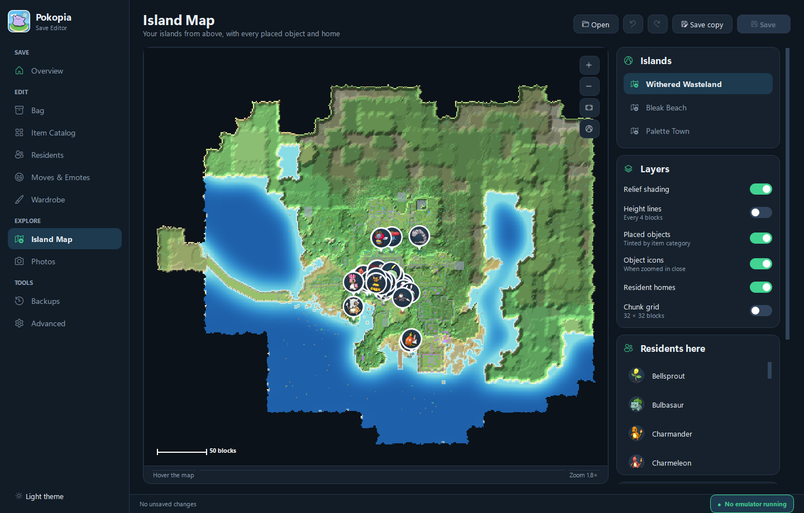
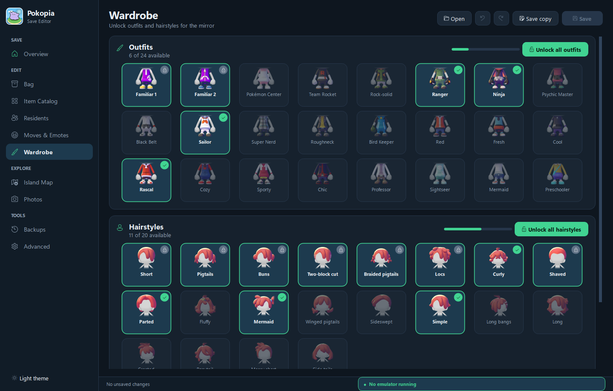
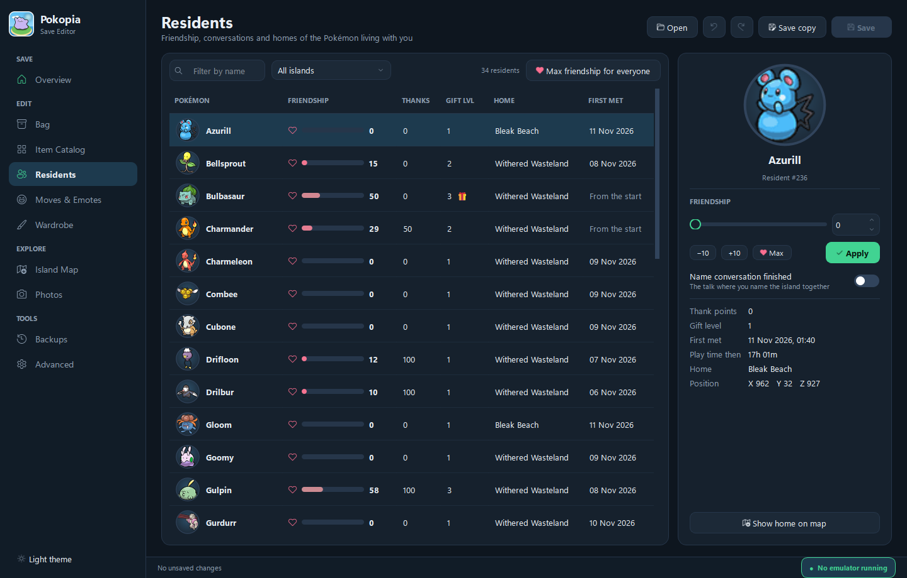
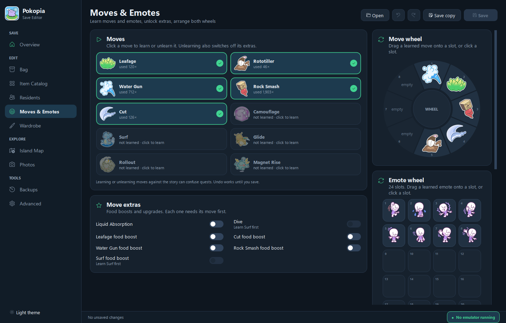
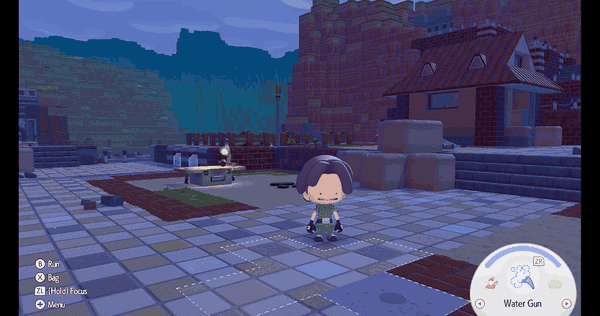

<div align="center">


# Pokopia Editor

**Edit your Pokopia save: bag, residents, moves, emotes, wardrobe, collection and your islands. Install game mods.**

[](https://github.com/cycalo/Pokopia-Editor/releases/latest)





</div>

---

## 🚀 Getting started

1. **[Download `PokopiaEditor.exe`](https://github.com/cycalo/Pokopia-Editor/releases/latest)**. There's nothing to install.
2. **Close your emulator.**
3. **Double-click the exe.** It finds your save on its own.

Supported emulators: **Eden · Yuzu · Suyu · Sudachi · Citron · Torzu · Ryujinx**.
If your save isn't found, click **Open → Browse for a folder**.
[Recompia](https://github.com/Dittobyte/Recompia) saves are found automatically too; choose which one opens at start on the Overview page.

> [!NOTE]
> If Windows shows *"Windows protected your PC"*, click **More info → Run anyway**.
> The warning appears because the app is new and unsigned.

---

## ✨ What you can do

| | Page | |
|:-:|---|---|
| 🏠 | **Overview** | Rename your player, see your stats, and use one-click actions: max friendship, learn every emote, unlock the wardrobe |
| 🎒 | **Bag** | Drag items into your bag, swap slots, copy with Ctrl, set amounts |
| 📖 | **Item Catalog** | Browse and search every item by category, then double-click to add it. Expansion Pass and event items are tagged and can be filtered |
| 💛 | **Residents** | Set friendship, see when you met each resident, and find their home on the map |
| ✨ | **Moves & Emotes** | Learn or unlearn with a click, then set up your move and emote wheels |
| 👕 | **Wardrobe** | Unlock any outfit or hairstyle, or all of them at once, including the Expansion Pass ones |
| ⭐ | **Collection** | Complete the Pokédex, Habitat Dex, recipes, item list, Human Records, Ancient Artifacts, Highlight Reel, and photo frames and filters, one at a time or all at once. Turn on upgrades and set your Life Coins |
| 🗺️ | **Island Map** | Edit your islands: move, place and delete objects, paint paths, raise or flatten the ground, and build any of 252 habitats in one click. Export as PNG |
| 📷 | **Photos** | Browse your in-game album and export full-size photos |
| 🛟 | **Backups** | Make, compare, restore and delete backups |
| 🧩 | **Mods** | Install game mods: Play as Pokemon, Unlimited Crafting Storage Range |

<table>
  <tr>
    <td></td>
    <td></td>
  </tr>
  <tr>
    <td align="center"><b>Island Map</b></td>
    <td align="center"><b>Wardrobe</b></td>
  </tr>
  <tr>
    <td></td>
    <td></td>
  </tr>
  <tr>
    <td align="center"><b>Residents</b></td>
    <td align="center"><b>Moves & Emotes</b></td>
  </tr>
  <tr>
    <td></td>
    <td></td>
  </tr>
  <tr>
    <td align="center"><b>Item Catalog</b></td>
    <td align="center"><b>Collection</b></td>
  </tr>
</table>

---

## 🧩 Mods



### Play as Pokemon <sub>(experimental)</sub>

Turn into any Pokémon in Pokopia. Use their abilities: flying Pokémon can fly, and Grow, Burn, Water and Generate Pokémon can use their ability. Works in co-op / Link Play: every player needs the mod installed.

1. On the editor's **Mods** page, press **Install**.
2. Restart the game and tick **Play as Pokemon** in its Properties → Add-Ons.
3. In the game, press **ZL + L3**. To choose the Pokémon, pick one on the Mods page and press **Transform**, or use ZL + D-pad.

| Press | Does |
|---|---|
| **ZL + L3** (left stick click) | Transform; press again to turn back |
| **ZL + D-pad Left / Right** | Previous / next Pokémon |
| **ZR** as a flying Pokémon | Take off, hold to rise |
| **ZL** while flying | Descend; hold on the ground to land |
| **ZL + ZR** while flying | Drop out of the air |
| **ZR** (Pokémon that can't fly) or **ZL + D-pad Down** | Use the Pokémon's ability: Grow, Burn, Water or Generate |
| **A** | Open doors, craft, open boxes and the bag, pick things up and build, as a Pokémon too |

- **Only for Pokopia 2.0.0** (update 655360).
- **Transform** on the Mods page needs the emulator on the same PC. On a console, pick the Pokémon before installing.
- **Experimental forms**, below the Pokémon list, turn you into things like the Master Ball.

**Without the editor:** `z-PlayAsPokemon-emulator-<version>.zip` from the [latest release](https://github.com/cycalo/Pokopia-Editor/releases/latest) (unzip into the emulator's `load` folder) or `z-PlayAsPokemon-SD-card-<version>.zip` (Atmosphère, untested). You start as Ditto; [how to start as another Pokémon](mods/play-as-pokemon/README-standalone.md#change-the-pokémon).

**Recompia:** copy `recompia_play_as_pokemon-1.7.1.pkmod` into Recompia's `mods` folder. F3 or ZL + R3 opens the Pokémon list; ZR or ZL + D-pad Down uses the Pokémon's ability (Grow, Burn, Water, Generate). [Install steps](recompia/play-as-pokemon/README.md).

If the camera judders while flying, turn off Running jump keeps speed (Settings > Game > Gameplay).

More details: [mods/play-as-pokemon](mods/play-as-pokemon/).

### Unlimited Crafting Storage Range

Crafting stations use the items in every storage box, chest and crate you have placed, at any distance, not only the boxes right next to them. No buttons.

1. On the editor's **Mods** page, press **Install**.
2. Restart the game and tick **Unlimited Crafting Storage Range** in its Properties → Add-Ons.

- **Only for Pokopia 2.0.0** (update 655360). Works together with Play as Pokemon.
- Not tested in multiplayer.

**Without the editor:** `z-UnlimitedCraftingStorageRange-emulator-<version>.zip` from the [latest release](https://github.com/cycalo/Pokopia-Editor/releases/latest) or `z-UnlimitedCraftingStorageRange-SD-card-<version>.zip` (Atmosphère, untested).

**Recompia:** copy `recompia_unlimited_crafting_storage_range-1.0.0.pkmod` into Recompia's `mods` folder. Windows and Linux. [Install steps](recompia/unlimited-crafting-storage-range/README.md).

More details: [mods/unlimited-crafting-storage-range](mods/unlimited-crafting-storage-range/).

---

## 🛡️ Your save is safe

- 💾 **Automatic backup** before every save, in `Documents\Pokopia_Save_Backups`
- 👀 **See every change** before it's written
- ↩️ **Undo / redo** everything, or restore any backup from the Backups page
- ⚠️ **Emulator check**: you get a warning if the emulator is still running
- 🔄 If the game saves while the editor is open, press **F5** to reload

---

## ⌨️ Shortcuts

| Keys | Action | | Keys | Action |
|---|---|---|---|---|
| `Ctrl+O` | Open a save | | `Ctrl+Z` | Undo |
| `Ctrl+S` | Save | | `Ctrl+Y` | Redo |
| `Ctrl+F` | Search | | `F5` | Reload |
| `Ctrl+1`–`9` | Switch page | | | |

---

<details>
<summary><b>🛠️ Running from source</b></summary>

<br>

Requires Python 3.

```bash
py -m pip install PySide6-Essentials pillow
py pokopia_gui.py
```

Command line tool: `py pokopia_cli.py --help`

Build the exe:

```bash
py -m pip install pyinstaller
py -m PyInstaller PokopiaEditor.spec --noconfirm
```

The exe stores its settings in `%APPDATA%\Pokopia Editor`.

</details>

<div align="center">
<sub>Save edditor built with data from <a href="https://github.com/berichan/PokoHex">PokoHex</a>
</div>
<div align="center">
<sub>Released under the <a href="LICENSE">GNU General Public License v3.0</a>. Pokémon names, icons and other game assets belong to Nintendo, Game Freak and The Pokémon Company. Fan-made tool, not affiliated with them.</sub>
</div>

## Linux support

Linux desktop support and the height-layer inspector were contributed by
**frinimini**. The original editor, versioning and Windows instructions above
are unchanged. Project source, issues and pull requests remain at
[cycalo/Pokopia-Editor](https://github.com/cycalo/Pokopia-Editor).
See [credits and licenses](CREDITS.md).

### Run from source

Install Python 3 with venv support, then:

```sh
git clone https://github.com/cycalo/Pokopia-Editor.git
cd Pokopia-Editor
python3 -m venv .build-venv
.build-venv/bin/python -m pip install -r packaging/requirements-linux.txt
.build-venv/bin/python pokopia_gui.py
```

The Linux integration uses XDG settings, system folder opening, emulator process
and save-folder detection, and bundled MIT-licensed Fluent System Icons. Close
the emulator before editing its on-disk save, and test changes with a backup.

### Build an AppImage

Install `appimagetool` from its official project, then run:

```sh
APPIMAGETOOL=/path/to/appimagetool bash tools/build_appimage.sh
chmod +x dist/PokopiaEditor-1.9.2-x86_64.AppImage
./dist/PokopiaEditor-1.9.2-x86_64.AppImage
```

The filename follows `version.py`. If FUSE is unavailable, try
`./dist/PokopiaEditor-1.9.2-x86_64.AppImage --appimage-extract-and-run`.
Build on the oldest distribution you intend to support: AppImage retains the
build host's glibc requirements. The contribution was tested on Ubuntu 26.10
x86_64 with glibc 2.44; older distributions are unverified. The build includes
license notices and a dependency manifest; see [source information](packaging/SOURCES.md).
Any upstream Linux downloads will appear in [this project's releases](https://github.com/cycalo/Pokopia-Editor/releases).

### Inspect height layers

In **Island Map**, use **Select** and click a map cell. The **Height layers**
panel groups its objects and contiguous terrain bands by Y height, including
concealed entries. Click an entry to reveal its level and select its object,
when present. **Lower level** and **Higher level** step through occupied heights;
**Show all heights** restores the full view. The height slider and roof-picking
shortcut are also available. These controls change the view, not save data.
The existing round brush sliders are unchanged.

### Experimental live editing on Linux

For Linux memory access, choose **Mods → Launch emulator**, select the Lichii
executable or AppImage, start the game and load into the world. Keep the editor
open. Launching through the editor permits access under the usual Linux
parent-process ptrace policy. If access is denied for one detected emulator,
the editor tries the other matching processes before reporting the error.

This was tested with the verified Pokopia 2.0.0 build and an in-game transformation
in Lichii. It does not establish support for every emulator or game version.
Cut and Rock Smash were reported not to work while transformed; the cause and
return-to-character workaround still need verification. Windows live editing
retains its existing behavior.
